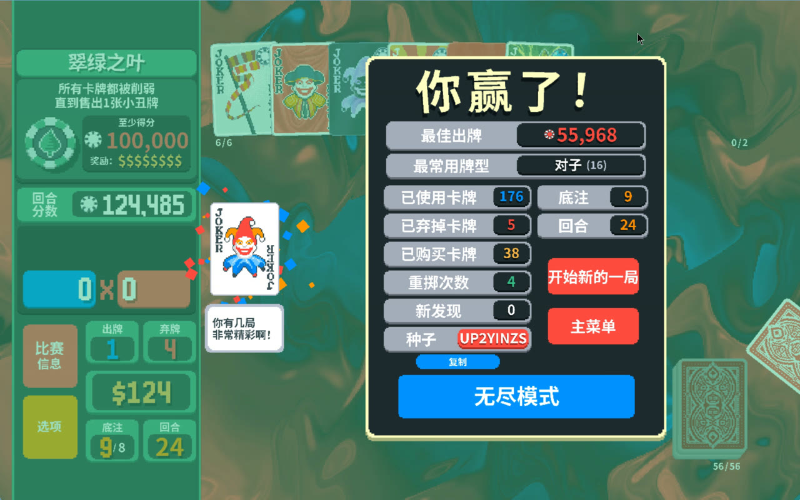

# laya-player — Laya 自己玩 Balatro

[Laya](https://huggingface.co/convaiinnovations/laya)（ConvAI，421M ModernBERT-large）是非生成式决策模型：
给定状态 + 候选项，输出每个候选的概率。这里把 Balatro 做成这种问题：每个决策点渲染成文本状态，列出选项，
Laya 选一个，执行，再观察。

[](https://huggingface.co/Steven10429/laya-balatro/blob/main/media/laya_balatro_win_UP2YINZS.mp4)

> 完整、最新的结果、图表和复现步骤见英文 [README](README.md)、[CHANGELOG](CHANGELOG.md)、[reports/REPORT.md](reports/REPORT.md)。

## 现状（v1.3，2026-10-09）

- **接口**：默认原始点牌（`select K♥` … `play selected`），一个决策多次点击，不预先组合牌型、不给估分。
  Stage 1 的组合候选接口仍可用（`LAYA_ACTIONS=combo`）。
- **训练**：用 HF 老师数据（[makemake/5k-balatro-games](https://huggingface.co/datasets/makemake/5k-balatro-games)）
  只做一次开局模仿，之后在 [jackdaw](https://github.com/TylerFlar/jackdaw-balatro) 模拟器里纯强化学习
  （PPO、同 seed 信用、v1.2 起部分出牌用模拟器搜索打标签）；真实 Balatro 只做验证。
- **结果**：最终冠军 `raw0056`，128 个固定新 seed 平均 5.63 关；真实游戏 Stage 2 全部对局平均 5.7 关。
  seed UP2YINZS 上由模拟器挑 seed、Laya 每一步自己点，真实游戏通关（27 关，Ante 10）。随机 seed 上基本赢不了
  （此前 541 局只赢 1 局）。
- **没用的尝试**：模仿老师越像、模拟器分数越低（Stage 1、Stage 4）；选项里附上计算出的后果（Stage 3）没有超过 `raw0056`；
  托管决策 API 零样本在同 64 个 seed 上平均 0.02–0.20 关。
- **Stage 5**：Claude 亲自玩真实 Balatro（`laya_player/claude_cli.py`，说明见 `runs_claude/STATE.md`）。

## 架构

```
Balatro + balatro-agent mod ──named pipe JSON-RPC──▶ bridge.py ─▶ live.py (状态→canonical, 动作→RPC)
                                                                     │
                                 game.py: canonical state → 文本 + 候选动作；desc.py: 效果原文
                                                                     │
                                       policy.py: Laya choice question → 选项概率 → 采样/训练
```

mod 管道同一时间只服务一个客户端：自对弈或 `claude_cli` 运行时请关闭占用 `\\.\pipe\balatro-mcp` 的 MCP 客户端。

## 运行

```bash
uv venv .venv -p 3.12 && uv pip install laya==0.3.21 polars huggingface_hub
uv pip install torch --index-url https://download.pytorch.org/whl/cu128
python -m laya_player.desc                       # 抽取本地化文本（需本机 Balatro）
python -m laya_player.hf_convert --per-shard 1500 --out data/hf_rich.jsonl
python -m laya_player.pretrain --data data/hf_rich.jsonl --out ckpt/rich_init.pt
./run_stage2_n8.sh                               # GPU 机上：开局模仿 + 纯 RL（simloop）
python -m laya_player.remote_sync --host <gpu-box>   # 在跑游戏的 PC 上同步冠军
python -m laya_player.realloop                   # 实机验证冠军（需游戏 + mod）
python -m laya_player.report                     # 图表 + reports/REPORT.md
```

状态在 `runs_sim/state.json`，日志 `runs_sim/simloop.log`、`runs/evolve.log`。
